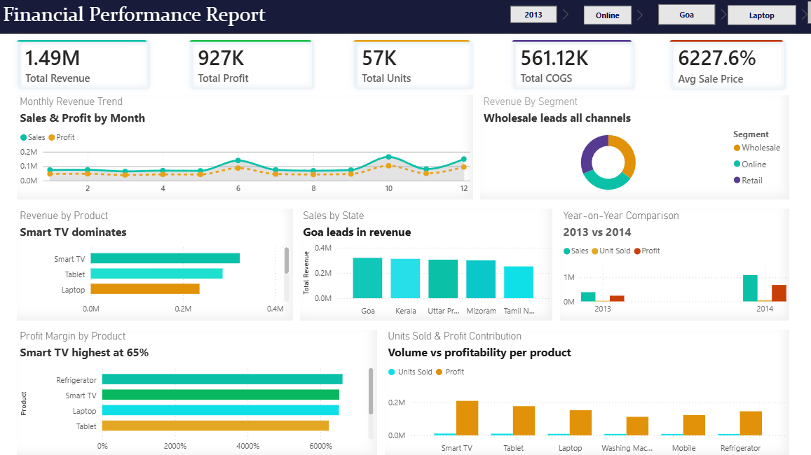

# Financial Performance Analysis Dashboard

## Project Overview
This project focuses on analyzing financial and sales performance using Power BI. The interactive dashboard provides insights into revenue, profit, product performance, sales trends, and regional performance.

## Tools Used
- Power BI
- Power Query
- DAX
- Data Visualization

## Key Performance Indicators (KPIs)
- Total Revenue: 1.49M
- Total Profit: 927K
- Total Units Sold: 57K
- Total COGS: 561.12K

## Key Insights
- Smart TV generated the highest revenue among the displayed product categories.
- Goa recorded the highest revenue among the displayed states.
- Wholesale contributed significantly to overall revenue.
- Smart TV showed the highest profit margin at 65%.
- Monthly sales and profit trends were analyzed to understand business performance.

## Dashboard Features
- Sales and Profit by Month
- Revenue by Segment
- Revenue by Product
- Sales by State
- Year-on-Year Comparison
- Profit Margin by Product
- Units Sold and Profit Contribution

## Dashboard Preview

## Skills Demonstrated
- Data Cleaning and Transformation
- Data Analysis
- DAX
- KPI Development
- Interactive Dashboard Design
- Business Insights and Reporting
